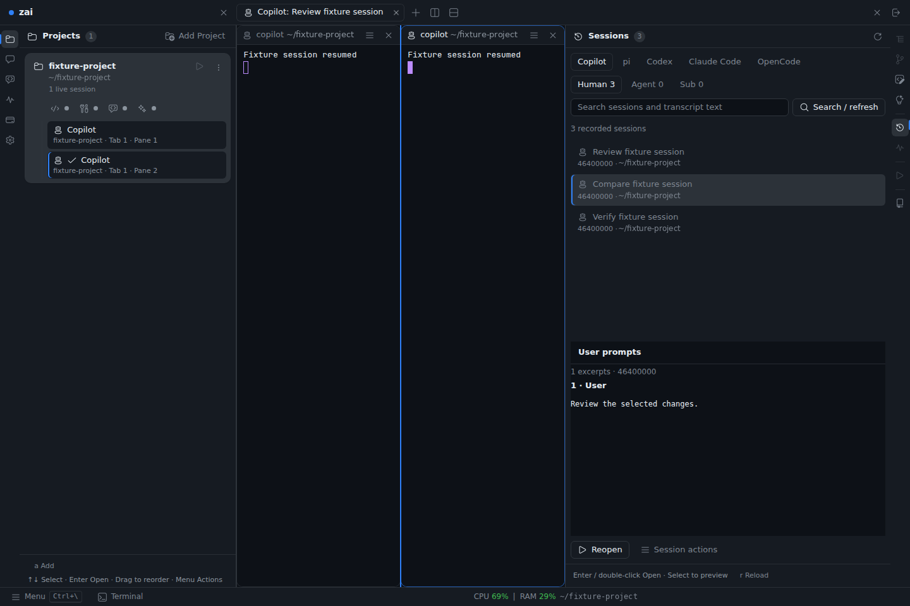
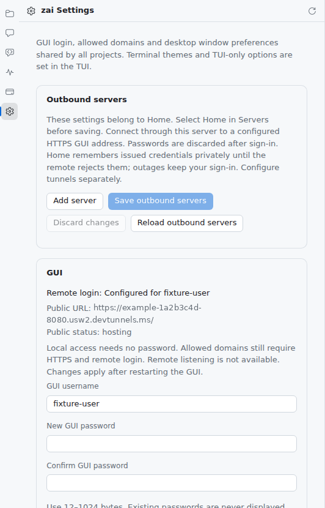
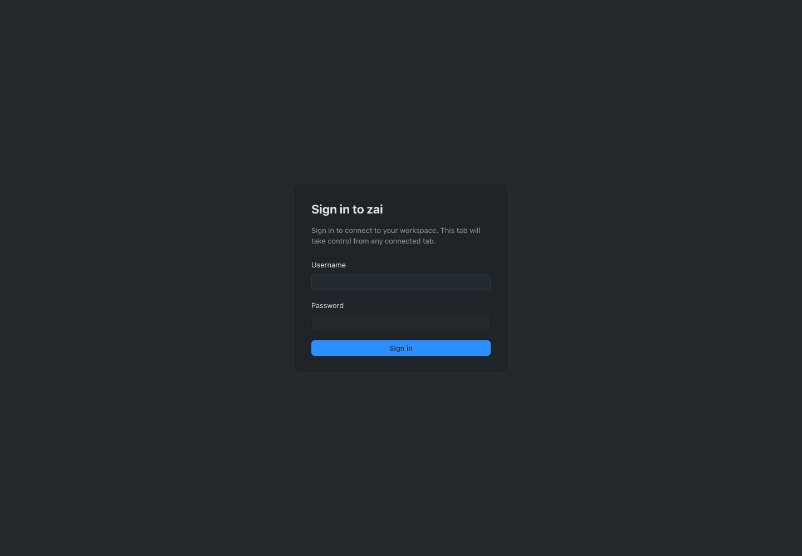
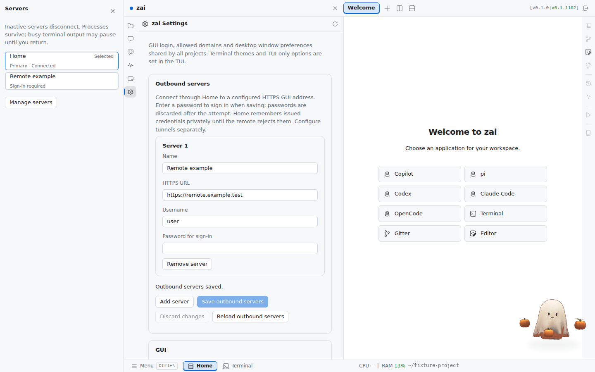
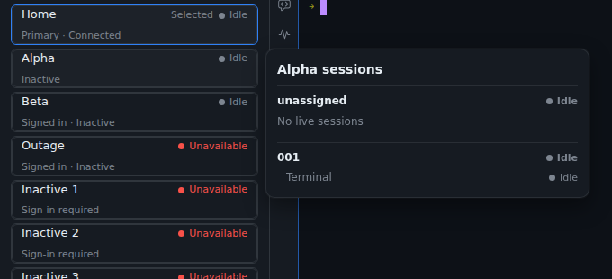

# zai servers setup guide

Documentation index

Run zai on one machine and use it from any browser: another computer, a tablet,
or your phone. This guide covers the browser GUI, `zai gui --tunnel`, signing in
from another device, installing the GUI as an app, and connecting several zai
servers to one Home GUI.

Run `zai gui -h` for the exact flags of your installed version. Field-level
details are in the GUI listener and login reference and
App settings > GUI servers.

## How it fits together

```text
 Phone / laptop browser ──HTTPS──▶ Microsoft Dev Tunnel ──▶ 127.0.0.1:<port>
 (or installed PWA)                 (or your own proxy)      zai GUI server
                                                             ├─ agents, shells, editor, Git viewer
                                                             └─ services, automations, Teams
```

- `zai gui` starts or reuses one background GUI server per profile and prints
  its URL. The server binds only to `127.0.0.1`; it never opens a public port.
- Remote access goes through an HTTPS tunnel or reverse proxy that you control.
  zai manages a Microsoft Dev Tunnel for you with `zai gui --tunnel`.
- Every non-local browser must sign in with the GUI username and password.
- The server keeps agents, panes, and scrollback running when a browser tab,
  the launching terminal, or the remote connection closes.

## 1. Start the GUI locally

On the machine that should run your agents (the **host**):

```bash
zai gui
```

The command prints a URL such as `http://127.0.0.1:<port>/`. Open it in a browser
on the same machine; local access needs no password. The port is saved, so the
URL and bookmark stay the same across restarts.

- `zai gui status` shows the URL, tunnel state, and whether a browser is connected.
- `zai gui stop` (or **Menu > Quit** in the GUI) stops the server and its panes.
- One browser tab controls the server at a time. Opening the URL in another tab
  or device takes control; reload a tab to take control back.
- The GUI and the TUI cannot own the same profile at the same time. Close the
  TUI completely (`ctrl+\` then `q`, **Close completely**) before running `zai gui`.



## 2. Set a GUI password

Remote browsers must sign in. Create the login once on the host:

```bash
zai gui stop
zai gui auth set <username>
```

The command prompts for the password twice without echo (8–1024 bytes) and
stores only a salted hash. You can also set it in **Settings > GUI** from the
local GUI or the TUI. `zai gui auth clear` removes the login.

An anonymous Dev Tunnel URL is reachable from the internet, so the GUI password
is the only gate. Use a strong, unique password.

## 3. Install and sign in to the Dev Tunnels CLI

zai never bundles or signs in to `devtunnel`. Install it from the
[official Dev Tunnels setup guide](https://learn.microsoft.com/azure/developer/dev-tunnels/get-started),
then sign in once on the host:

```bash
devtunnel user login
# on a machine without a display:
devtunnel user login -d
```

## 4. Run `zai gui --tunnel`

```bash
zai gui --tunnel
```

zai then:

1. Starts (or reuses) the local GUI server and prints its local URL.
2. Creates or reuses one persistent tunnel for this profile and adds only its
   exact HTTPS host to the GUI's allowed domains.
3. Waits until the relay confirms it is ready, then prints the public URL, for
   example `https://<id>-<port>.<region>.devtunnels.ms/`.

If no GUI password exists, an interactive terminal offers to set one; a
noninteractive launch prints the `zai gui auth set <username>` command instead.
You can run `zai gui --tunnel` against an already running local GUI to add the
tunnel without a restart. Later plain `zai gui` launches keep hosting the saved
tunnel, so the public URL stays the same.

**Settings > GUI** shows the public URL and the hosting state:



## 5. Connect from another device or your phone

Open the public URL in any modern browser and sign in with the GUI username and
password.



After sign-in you get the same workspace as the host: projects, agent panes,
the editor, Diff Review, Teams, Settings, and the native pages. Sessions that
are idle for 30 minutes sign out; agents keep running on the host.

On a phone or narrow window:

- Rails overlay the workspace, and a one-finger swipe scrolls terminals.
- The footer **Keys** button sends **Shift+Left**, **Esc**, and **Shift+Enter**
  to the focused terminal, so you can answer agent prompts without a hardware
  keyboard.
- Paste images or drop up to eight files onto an agent terminal.

<p align="center">
  
</p>

### Install it as an app (optional)

Supporting browsers can install the GUI as a progressive web app (PWA) from
**Menu > Install App** over HTTPS or loopback. The installed app keeps the URL it
was installed from. If the host is offline, it still opens and shows a **Retry
connection** page telling you to run `zai gui` on the host.

## 6. Connect several servers to one Home GUI

Each machine can run its own tunneled GUI. Your local GUI (**Home**) can then
switch between them without opening separate tabs.

1. On each remote host, complete steps 2–4 and note its public URL.
2. In your Home GUI, open **Settings > GUI > Outbound servers** and add each
   server's display name, HTTPS URL, and username (up to 32 servers).
3. Enter each server's password beside it and save to sign in. Home stores an
   issued sign-in capability, never the password.
4. Click the highlighted **Servers** button in the footer and choose a server.



While the Servers rail is open, each card refreshes its session status every 15
seconds. Hover or focus a card to see per-project and per-session status
without taking control of that server:



- Selecting a server routes projects, files, terminals, and actions to it. Only
  the selected server has a live connection; processes on the others keep
  running.
- The TUI edits and signs in to the same server list; switching servers is
  GUI-only.
- Remote servers must run a compatible zai release. Self-routing and chained
  gateways are refused.

## Use your own HTTPS proxy instead

If you already run a tunnel or reverse proxy, point it at
`http://127.0.0.1:<port>` on the host and register its public origin:

```bash
zai gui --public-url https://gui.example.test
```

The proxy must terminate HTTPS, preserve the public `Host`, set
`X-Forwarded-Proto: https`, and support WebSocket upgrades. See
HTTPS tunnels and reverse proxies
for the exact header rules and a Cloudflare Quick Tunnel example.

## Update a remote host

**Menu > Update and restart** runs on the selected server, including a remote
one. The host runs `zai gui stop`, `zai update`, and `zai gui`, and the browser
reconnects when it returns. If the update needs terminal input or fails, sign in
to the host and run those commands yourself; the log is `logs/gui-update.log` in
the host's profile.

## Troubleshooting

| Symptom | What to check |
| --- | --- |
| `zai gui` says the console owns the profile | Close the TUI completely, or use a different profile. |
| `--tunnel` reports a missing CLI or login | Install `devtunnel` and run `devtunnel user login`. |
| Tunnel startup fails or times out | Run `zai gui --tunnel` again. For persistent failures, read `logs/desktop/runtime.log` in the active profile. |
| Remote browser shows the sign-in page again | The session was idle for 30 minutes, the server restarted, or the login changed. Sign in again. |
| Remote sign-in is rejected | Confirm the username and password set with `zai gui auth set`. Five attempts per minute are allowed. |
| WSL host, Windows browser cannot reach the local URL | Windows needs localhost forwarding to the saved GUI port. The tunnel URL works without it. |
| Clipboard permission prompts repeat | Keep the same URL and browser profile. See Clipboard permissions. |

## Security notes

- The GUI server never binds to a public interface and has no built-in TLS.
  Remote access always passes through HTTPS and the GUI login.
- Login attempts are rate-limited. Changing the password, username, or allowed
  domains signs out affected remote sessions.
- Keep the profile's `gui.json`, `remote-servers.json`, and
  `remote-credentials.json` private. They never contain plaintext passwords.
