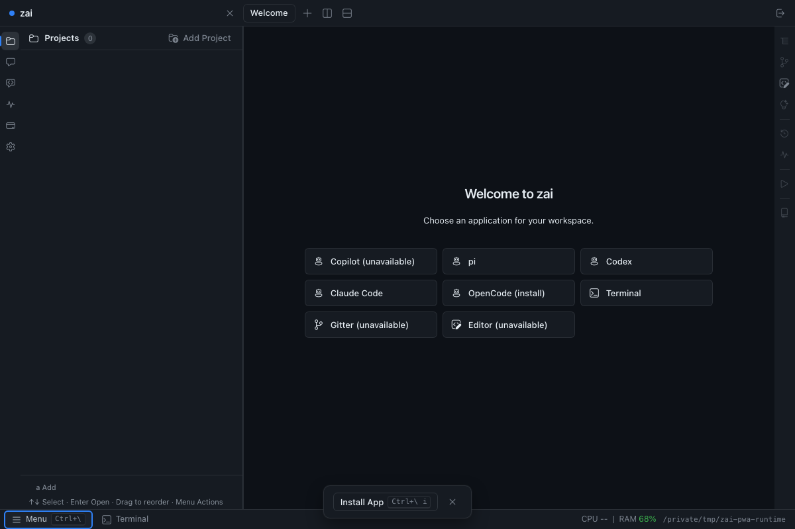
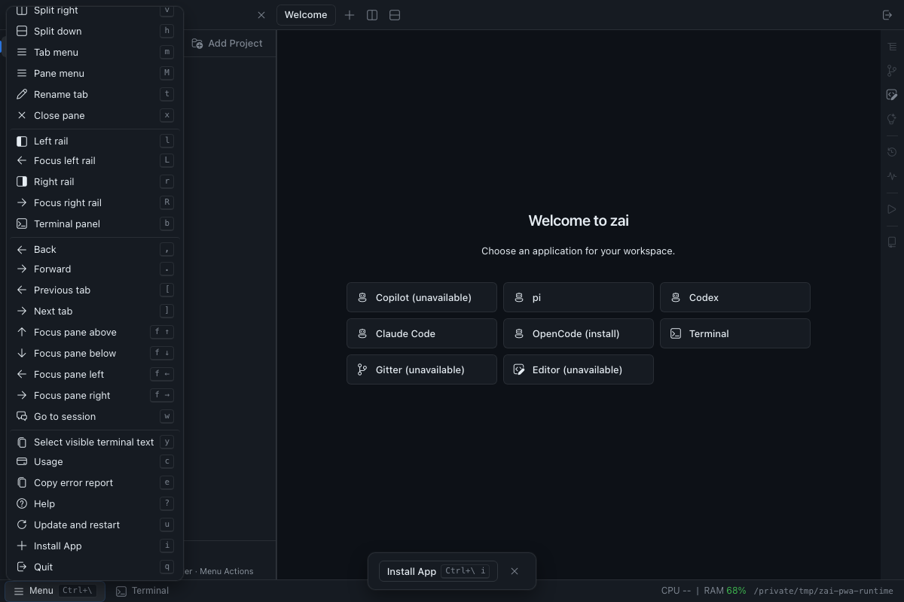

# Install and configure zai

See anonymous profile storage for data ownership.
Persistent local data belongs exclusively to `<installation-home>/profiles/anonymous`.
Old installation-root data and migration journals are ignored during launch and
installation. An absent anonymous profile starts fresh; existing profile data is
retained on updates.

## Prerequisites

Installing a pre-built release requires **Python 3.10 or newer** on PATH. On macOS/Linux, the command below also needs `curl`; the bootstrap supports `curl` or `wget` when run from a downloaded file, and `sha256sum` or `shasum` for checksum verification. ZIP extraction uses `unzip`, `bsdtar`, a ZIP-capable `tar`, or the selected Python interpreter. GitHub sign-in and a coding-agent CLI are not needed to install the package.

The bootstrap checks that Python runs and meets the minimum version before downloading the release. It tries `python3`, then `python` on macOS/Linux; on Windows it tries `py -3`, `python`, then `python3`. If none works, install [Python](https://www.python.org/downloads/), enable its PATH option on Windows, open a new terminal, and rerun the installer.

Git and an authenticated coding-agent CLI are needed for repository sessions and services. Node.js/npm is needed for npm-distributed coding agents and automatic provisioning of supported providers; the zai package installer does not install coding agents. Provider authentication is separate from installing zai. See [getting started](?id=zai-cli&doc=docs--getting-started#installation), [Claude Code](?id=zai-cli&doc=docs--claude-code), and [OpenCode](?id=zai-cli&doc=docs--opencode) for provider requirements.

## Install the public release

macOS / Linux:

```bash
(installer=$(mktemp) || exit; trap 'rm -f -- "$installer"' EXIT; curl --proto '=https' --proto-redir '=https' -fsSL https://phoenixzqy.github.io/install/zai-cli.sh -o "$installer" && sh "$installer")
```

Windows PowerShell:

```powershell
irm https://phoenixzqy.github.io/install/zai-cli.ps1 | iex
```

The bootstrap reads the public release manifest over anonymous HTTPS, verifies the archive's SHA-256, and runs **`install.py` from the archive root**. That Python entry point and its bundled installer modules create `~/.zai`, install the public `zai`, `zai-editor`, and `zai-gitter` commands, `zai-hook`, and the packaged `.copilot` home, and update persistent user PATH. Downloads are removed on success or failure. `ZAI_INSTALL_DIR` selects another destination.

Public release packages include the CLI, terminal tools, Go GUI server and
production web assets. Run `zai gui` from any directory to start or reuse its
background server and print its URL. Open the URL in a modern browser or launch
your installed zai PWA; the command never opens a browser automatically.
The launcher uses that folder
to select its registered workspace. Desktop installation registers a launcher in the
current user's application menu: a Desktop Entry on Linux, a Start Menu shortcut
on Windows, or an application link in `~/Applications` on macOS. Each has an
installation-specific name so custom installations can coexist. Modified or
unowned shortcuts are preserved; uninstall removes only an unchanged owned
shortcut. Linux honors `XDG_DATA_HOME`, and Windows uses the user's `APPDATA`.

The GUI uses the current anonymous profile and the TUI's shared icons and themes.
Close the TUI completely, including its detached server, before opening the GUI
against that profile. `zai gui` starts one background server per profile. Another
invocation reuses the server and selects the caller's project. Only one tab or PWA
window can control it; a new authorized connection replaces the previous one.
Refresh restores the existing panes.

For optional PWA installation, choose **Install App** between **Update and restart**
and **Quit** in the GUI Menu, or press `Ctrl+\`, then `i`. When the browser offers
installation, a dismissible notification opens the same native browser prompt.
Closing the notification hides it for the tab session, including reloads; the
menu remains available. Canceling a browser prompt consumes that offer; a later
browser offer allows another attempt. Browsers without the prompt API show manual
instructions (Safari: File → Add to Dock on Mac, Share → Add to Home Screen on
iPhone/iPad). Installation controls are hidden in a standalone PWA and after an
accepted installation. Browsers cannot universally detect an app installed in a
different window; they may offer Open in app instead. HTTPS or a trusted loopback
URL is required.





After an online visit prepares offline support, opening the app with its server stopped
shows an instruction to run `zai gui` on the hosting machine and retry. The app
keeps its installed origin. Every load checks the server for the latest UI; only
public UI files are cached for offline fallback, never authentication or workspace
data. The PWA cannot start the server itself. Remote listening remains unavailable.

Closing the browser tab or launching terminal leaves the server and panes running.
Use the GUI's Quit action or `zai gui stop` to close its owned sessions before opening
the TUI or updating from a terminal. `zai gui status` reports whether a server and
browser are connected. TUI detach/reconnect and independent services are unchanged.
The server binds only to loopback and uses a private launch capability. A modern
browser is required. WSL uses the Linux package and tools; WSLg is not required,
and the browser can run on Windows.

Open a new terminal after installation, then verify:

```text
zai version
zai doc
zai -h
```

Use `zai <command> -h` for the flags supported by your installed version. The installed CLI documentation is the source of truth for commands, configuration fields, defaults, and workflows.

### If installation fails or `~/.zai` is missing

The folder is created by the bundled Python installer, not by downloading or extracting the archive. Missing or unsupported Python, a failed download or checksum, or a malformed archive can stop the bootstrap before that step. Read the terminal's error message, correct the reported problem, and rerun the installer; creating an empty `.zai` folder does not install the application.

For a manual installation, download the archive for your platform from the [releases page](https://phoenixzqy.github.io/apps/releases/?id=zai-cli), verify its published SHA-256, and extract the entire archive. From its root, run `python3 install.py` on macOS/Linux or `py -3 install.py` on Windows, using a Python 3.10+ interpreter. Keep the adjacent `_installer.py` and other bundled modules together. Directory creation or write failures name the affected path; choose a writable destination with `--install-dir` when needed.

If installation succeeded but `zai` is not found, open a new terminal for the persistent PATH change, or run the executable by its full path (`~/.zai/zai` on macOS/Linux, `%USERPROFILE%\.zai\zai.exe` on Windows). Check `ZAI_INSTALL_DIR` if the default folder is absent.

## Configure each repository

From inside a local checkout with a supported GitHub or Azure DevOps remote, run:

```text
zai config show
zai config path
```

`config show` creates missing default settings and reports `initialized=true` and the detected repository identity. `config path` locates the active profile's file without creating one. Configuration lives under `~/.zai/profiles/anonymous/configs/`, outside the checkout. Existing settings and active profile choices are preserved; invalid files and missing selected named profiles remain errors to repair.

Review or edit the file reported by `config path`, or use `zai config update` for the interactive editor. Preserve its repository identity and existing settings. The output of `config show` is a report, not a configuration file; do not write it back as JSON. Read the "Onboard a repository without the interactive editor" section of `zai doc` for the current schema and model choices.

Verify any edits with `zai config show`, then start the chosen delivery services:

```text
zai start dev,review,pr-babysitter
```

Run `zai` to open the console. Repeat configuration from each repository you want to use. Choose scopes using the [service workflow table](?id=zai-cli&doc=docs--services-and-pollers#choose-the-workflow-before-starting); startup checkboxes do not change them. For ADO dev, configure the saved work-item query and effective work-item project before starting. For ADO group reviews, configure the reviewer-group allowlist. For ongoing usage, consult `zai doc`, `zai config -h`, and the [configuration reference](?id=zai-cli&doc=docs--config).

Before installing or updating a running console, attach with `zai` and choose **Close completely**. A detached local console still owns its processes and lifetime lock; the installer refuses to change its files until shutdown. See local console server.
